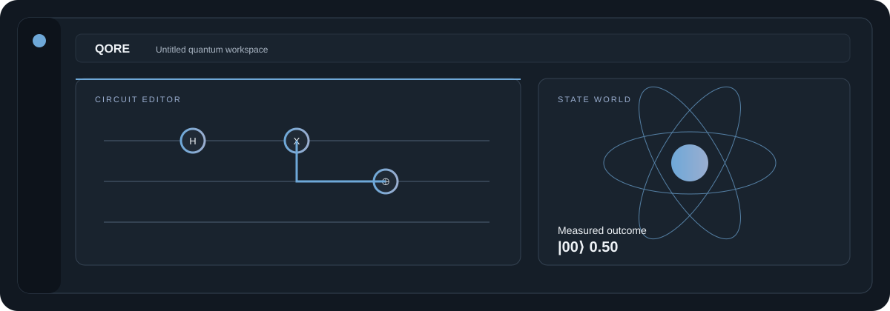
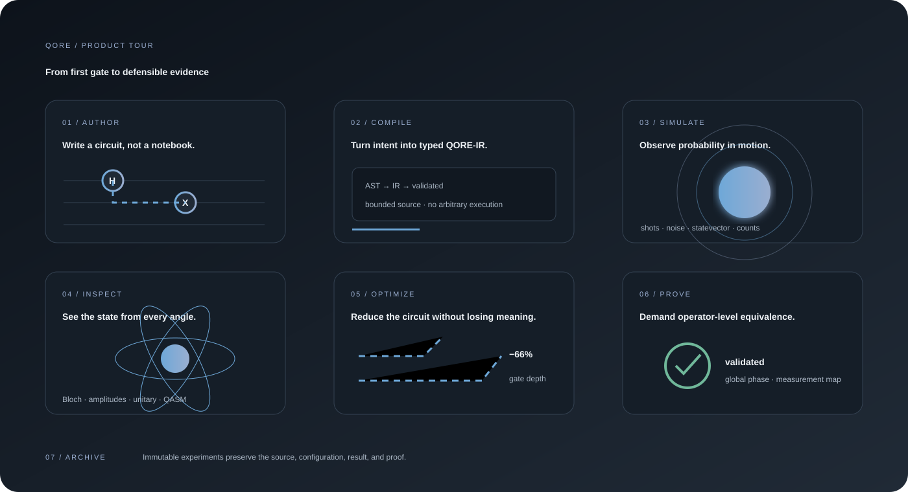
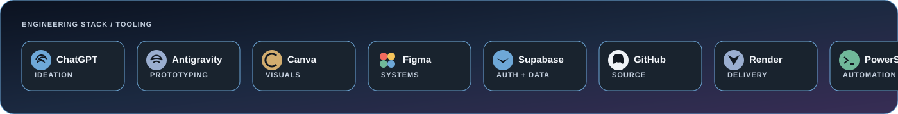
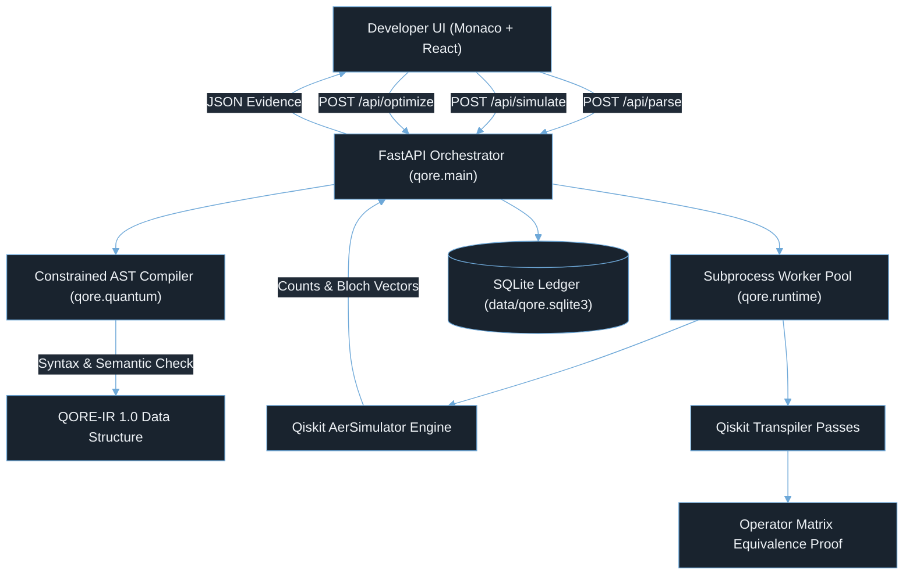
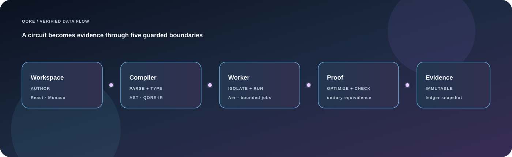

# QORE · Quantum Operating & Research Environment

> **A local, evidence-driven quantum development OS & IDE.**
> *AI proposes. Verification checks. Experiments provide the immutable evidence.*

QORE is a focused quantum development environment for writing circuits, proving transformations, and inspecting results. It opens empty by design: users create their own files and projects, then run them through a bounded compiler, isolated simulator, visual laboratory, and immutable experiment ledger.

The welcome now opens automatically. **Get Started** creates a single editable three-qubit circuit on request. Hosted accounts use verified email/Google sessions and owner-scoped cloud records. See the [production setup guide](docs/PRODUCTION.md) for provider activation, Render environment settings, security boundaries, and the acceptance checks required before release.

## About QORE

QORE is a research-grade quantum workspace designed to make experimental computing understandable, reproducible, and reviewable. It gives a developer one calm surface for authoring a circuit, compiling it into a typed intermediate representation, running controlled simulations, exploring quantum state evidence, optimizing transformations, and preserving the complete result as an immutable experiment.

The project is built for quantum learners, algorithm engineers, research teams, and hackathon builders who need more than a code editor and more than a chart. QORE connects the source, execution settings, measurements, visual state, optimization proof, and historical record so that every result can be inspected and repeated.

### What makes it different

- **Evidence over guesswork:** simulation results include ideal probabilities, measured counts, state amplitudes, Bloch vectors, metrics, and total variation distance.
- **Safe by construction:** circuit source is parsed through a constrained AST pipeline and executed in bounded worker processes; arbitrary Python execution is not permitted.
- **Proof-aware optimization:** candidate circuits are accepted only when unitary behavior and terminal measurement mappings remain equivalent within tolerance.
- **A clean starting point:** the IDE opens as an empty workspace, so user-created files and experiments remain the center of the product.
- **Visual understanding:** the Lab combines classic scientific views with an interactive 3D State World that makes probability and measurement behavior tangible.

### The QORE workflow

```text
Author → Compile → Simulate → Inspect → Optimize → Prove → Archive
```

QORE is intentionally local-first, transparent, and extensible. A local SQLite ledger provides dependable development and offline work, while the authenticated cloud boundary can add owner-scoped identity and persistence without exposing secrets to the browser.



<p align="center"><a href="https://github.com/ganeshkumarchalla/Qore/tree/main">Explore the source</a> · <a href="https://github.com/ganeshkumarchalla/Qore/issues">Report an issue</a> · <a href="docs/QUANTUM.md">Read the quantum model</a></p>

## Product tour



The visual tour maps the complete journey: author → compile → simulate → inspect → optimize → prove → archive. The animation is intentionally self-contained, with no remote image or tracking dependency.

### Build surface



The stack marquee shows the tools and services used to build and ship QORE: ChatGPT, Antigravity, Canva, Figma, Supabase, GitHub, Render, PowerShell, and the Codex Security plugin. Each pill includes a visible tool mark. QORE’s runtime remains first-party and server-side; these tools are represented as the engineering workflow, not runtime dependencies.

---

## Quickstart & Running the Application

### 1. Start the Backend & Production Frontend
In PowerShell from the repository root:
```powershell
.\.venv\Scripts\python.exe -m uvicorn qore.main:app --host 127.0.0.1 --port 8000
```

Open **[http://127.0.0.1:8000](http://127.0.0.1:8000)** in any modern browser. FastAPI serves the compiled Vite frontend production bundle directly from `frontend/dist/`.

### 2. Frontend Development Mode (Hot Reload)
To develop the React frontend with instant Vite HMR:
```powershell
# In terminal 1 (FastAPI backend):
.\.venv\Scripts\python.exe -m uvicorn qore.main:app --host 127.0.0.1 --port 8000

# In terminal 2 (Vite dev server):
cd frontend
pnpm dev
```
Vite runs on **`http://127.0.0.1:5173`** and proxies `/api` calls to port `8000`.

### 3. Building Frontend for Production
```powershell
cd frontend
cmd.exe /c corepack.cmd pnpm build
```
*(Outputs minified bundle into `frontend/dist/`)*

### 4. Running Verification Test Suite
```powershell
# Run backend pytest suite
.\.venv\Scripts\python.exe -m pytest

# Run end-to-end acceptance script
.\.venv\Scripts\python.exe scripts\acceptance.py
```

---

## Project Directory & Architecture Map

```
QORE/
├── backend/
│   ├── qore/
│   │   ├── __init__.py        # Package initialization & version definitions
│   │   ├── main.py            # FastAPI app, API route contracts, RequestGuard, CORS
│   │   ├── quantum.py         # Constrained Python AST parser, QORE-IR conversion, Aer simulation, transpiler, operator equivalence proof
│   │   ├── runtime.py         # Subprocess worker execution pool, timeout guards, memory limits
│   │   ├── worker.py          # Standalone isolated worker process executing quantum routines
│   │   ├── store.py           # SQLite transactional repository (projects, runs, experiments)
│   │   └── telemetry.py       # Performance timers, gate counting, bit ordering helpers
│   ├── tests/                 # Comprehensive Pytest test cases
│   └── data/
├── data/
│   └── qore.sqlite3           # Active SQLite database file
├── frontend/
│   ├── src/
│   │   ├── App.tsx            # Main IDE shell, layout controller, state orchestrator
│   │   ├── Explorer.tsx       # QORE file tree, circuit files, and context menus
│   │   ├── Terminal.tsx       # Integrated interactive terminal, problems/diagnostics analyzer, CLI commands
│   │   ├── Circuit.tsx        # SVG quantum circuit wire renderer, metric cards
│   │   ├── QuantumVisuals.tsx # 3D Bloch spheres (focused/grid), unitary matrix heatmap, QASM viewer
│   │   ├── Panels.tsx         # Lab (simulation histogram/flux bars), Forge (optimization), Research (ledger), Intelligence
│   │   ├── WelcomeModal.tsx   # Gradient animated QORE entry screen
│   │   ├── AuthModal.tsx      # Managed QORE identity sign-in surface
│   │   ├── SettingsModal.tsx  # QORE preferences, noise models, and simulation defaults
│   │   ├── CommandPalette.tsx # Quick-open command palette (Ctrl+K / Ctrl+Shift+P)
│   │   ├── Icons.tsx          # QORE SVG icon registry
│   │   ├── types.ts           # Shared TypeScript interfaces (IR, Metrics, Simulation, Optimization, Project)
│   │   └── styles.css         # IDE styling, animations, and theme variables
│   ├── package.json           # Frontend dependencies (React 18, Monaco, Lucide, Vite)
│   └── vite.config.ts         # Vite build configuration, dev proxy, chunking options
├── docs/                      # Formal engineering specs, IR grammar, security invariants
├── scripts/                   # PowerShell & Python launch and acceptance scripts
└── requirements-lock.txt      # Python dependencies lockfile (Qiskit 2.x, Qiskit Aer, FastAPI, Uvicorn)
```

---

## Core System Architecture & Subsystems





### 1. Monaco Editor & Constrained AST Compiler
- **Strict Bounded Python AST**: QORE does **NOT** execute arbitrary Python code via `eval()` or `exec()`. Instead, [`backend/qore/quantum.py`](file:///c:/Users/ganes/OneDrive/QORE/backend/qore/quantum.py) parses the code into Python's Abstract Syntax Tree (`ast.parse`) and inspects statements against a strict whitelist of quantum operations:
  - Allowed gates: `h`, `x`, `y`, `z`, `s`, `sdg`, `t`, `tdg`, `rx`, `ry`, `rz`, `p`, `u`, `cx`, `cy`, `cz`, `ch`, `swap`, `ccx`, `cp`, `rxx`, `ryy`, `rzz`, `barrier`, `measure`, `measure_all`.
  - **Deferred Measurement Invariant**: The compiler strictly enforces terminal measurements (`NON_TERMINAL_MEASUREMENT`). No quantum unitary gates may follow a measurement instruction. Quantum teleportation and feedforward protocols must be formatted via the deferred measurement principle (`qc.cx` / `qc.cz` controlled unitary operations before measurement).
- **Multi-File Monaco Integration**: Editor language dynamically adjusts:
  - `.py` files $\rightarrow$ `python`
  - `.qasm` files $\rightarrow$ `c`
  - `.md` files $\rightarrow$ `markdown`
  - `.json` files $\rightarrow$ `json`
  - Non-Python files bypass circuit compilation to prevent syntax parse errors.

### 2. AerSimulator Execution Worker (`qore.runtime` & `qore.worker`)
- Simulation executes in an isolated worker subprocess with CPU and memory limits.
- **Outputs**:
  - `counts`: Observed bitstring histogram (little-endian format: $c[n-1]\dots c[0]$).
  - `probabilities`: Normalized empirical measurement probabilities.
  - `theoretical_probabilities`: Analytical statevector reference probabilities.
  - `bloch_vectors`: Single-qubit Bloch sphere coordinates $(x, y, z)$ with purity $\mathcal{P} = \sqrt{x^2+y^2+z^2}$ and spherical coordinates $(\theta, \phi)$.
  - `statevector_amplitudes`: Complex statevector amplitudes $(\alpha_i + i\beta_i)$ for all $2^n$ basis states.
  - `tvd`: Total Variation Distance divergence from ideal output.
- **Hardware Noise Models**: Optional depolarizing quantum noise ($p \in [0, 0.5]$) and readout bit-flip error rates ($p_{\text{ro}} \in [0, 0.5]$).

### 3. Transpiler Forge & Formal Operator Equivalence Proof
- **Optimization Levels**: Level 0 (None), Level 1 (Light peephole), Level 2 (Default SABRE coupling), Level 3 (Heavy synthesis).
- **Operator Equivalence**: [`validate_ir()`](file:///c:/Users/ganes/OneDrive/QORE/backend/qore/quantum.py) calculates the full unitary operator matrices $\mathcal{U}_{\text{orig}}$ and $\mathcal{U}_{\text{cand}}$ using `qiskit.quantum_info.Operator`. It checks if:
  $$\frac{|\mathrm{Tr}(\mathcal{U}_{\text{orig}}^\dagger \mathcal{U}_{\text{cand}})|}{2^n} = 1.0 \pm 10^{-7}$$
  Terminal measurement mappings are strictly checked. If valid, the UI awards **Semantically Validated**.

### 4. Interactive Terminal & Real-Time Diagnostics
- **Production Problems Tab**: Real-time static AST analyzer (`analyzeWorkspaceProblems()`) identifies compiler errors, unclosed parentheses, and out-of-bounds qubit registers. Clicking any diagnostic row focuses Monaco on the exact line and column.
- **QORE-first branding**: Terminal output and product surfaces use QORE terminology (`[KERNEL]`, `[COMPILER]`, `[RESOURCE]`, `[CLOUD]`).
- **Supported Terminal Commands**:
  - `qiskit [run|compile|transpile|backends|statevector|unitary|metrics]`
  - `az quantum [workspace|jobs|target list|execute|status]`
  - `qsharp [run|estimate|build]`
  - `simulate`, `transpile`, `metrics`, `statevector`, `ast`, `status`, `help`, `clear`, `cat`, `whoami`, `uname`, `date`.

### 5. Advanced Visualizations
- **3D Bloch Spheres**:
  - *Focused Mode*: Single interactive qubit with spherical coordinate readouts and continuous orbit animations.
  - *Multi-Qubit Grid Mode*: Parallel 3D rendering of every qubit in the register with animated coordinate axes and purity indicators.
- **Dynamic Lab Flux Bars**: Basis state probability histogram features CSS animated flux bars (`.animated-flux-bar`) and dominant state pulse badges.

### 6. QORE Gradient Entry Screen
- High-performance, full-viewport entry overlay featuring **ONLY**:
  **`Welcome to Qore`**
- Floating cosmic gradient auroras (`aura-cyan`, `aura-purple`, `aura-magenta`), rotating quantum orbital rings, glowing nucleus photon, and smooth scale/fade dismissal.
- Remembers user preference in `localStorage` (`qore_welcome_dismissed`) and can be replayed anytime via `Help -> Welcome to Qore`.

### 7. Authentication boundary
- **Activity Bar Bottom Pinning**: The Account icon (`<Icon name="account" size={20} />`) and Settings icon (`<Icon name="gear" size={20} />`) are strictly pinned at the bottom of the left sidebar activity bar. They are excluded from the top bar to maintain a clean layout.
- **Managed identity**: Email and Google sign-in are designed to be provided by the connected authentication service. QORE does not fabricate users, store passwords, or persist bearer tokens in browser storage.

---

## Database Schema

The persistent SQLite database is located at `data/qore.sqlite3` (overridable via `QORE_DB_PATH`).

### Tables
1. **`projects`**: Mutable user projects (`id`, `name`, `source`, `created_at`, `updated_at`).
2. **`runs`**: Immutable execution log of every simulation and optimization (`id`, `kind`, `source`, `source_hash`, `project_id`, `configuration`, `result`, `error`, `created_at`).
3. **`experiments`**: Saved scientific snapshots linking circuit source, simulation results, optimization evidence, and compiler telemetry.

The workspace starts without user files or seeded projects. Optional circuit examples are available only through an explicit user action and are never injected into the editor on startup.

---

## Critical Invariants & Rules for Next Updates

When building upon or modifying QORE, ensure the following constraints are preserved:

1. **Terminal Measurement Invariant**: Quantum circuits must use terminal measurements. No gates are allowed after a measurement instruction.
2. **Left Sidebar Pinning**: The Account and Settings icons must remain exclusively at the bottom of the left Activity Bar. Do not place them back on the top bar.
3. **Viewport Dimension Locking**: `.vscode-root` is strictly pinned with `position: absolute; inset: 0;` and `.vscode-statusbar` is locked to `flex: 0 0 24px !important; height: 24px !important;`. The terminal dock is locked to `flex: 0 0 240px !important; height: 240px !important;` to prevent layout jumps between Forge, Lab, and Studio.
4. **Zero Vendor Promotional References**: Maintain first-party QORE Quantum OS branding (`[KERNEL]`, `[CLOUD]`, etc.) across all terminal outputs and UI banners.
5. **Security Request Guard**: The backend `RequestGuard` middleware restricts write methods (`POST`, `PUT`, `DELETE`) to authorized local loopback origins (`http://localhost:8000`, `http://127.0.0.1:8000`, `http://localhost:5173`, `http://127.0.0.1:5173`).
6. **No Arbitrary Python Execution**: Never introduce `exec()` or `eval()` for circuit parsing. Always process quantum sources through AST traversal in `quantum.py`.

---

## Release discipline

- Changes are developed on `editing`, verified, promoted to `production`, and then fast-forwarded to `main` for deployment.
