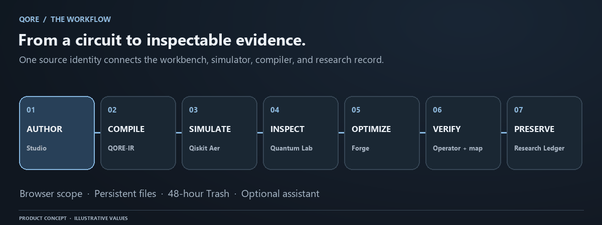
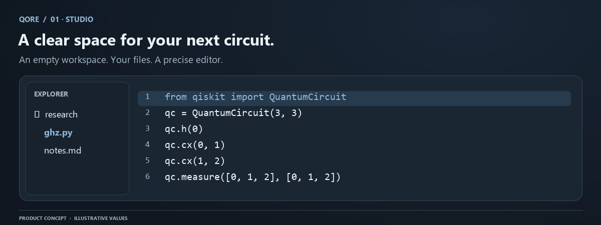
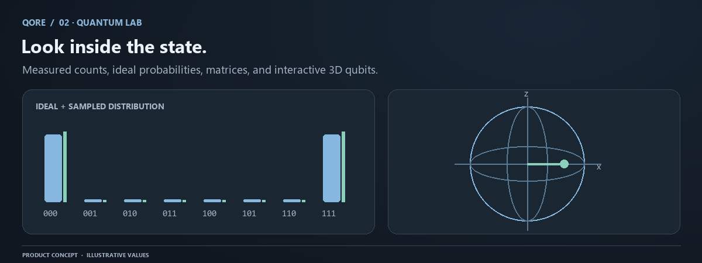
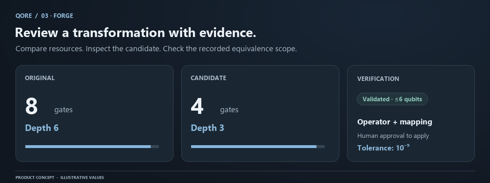
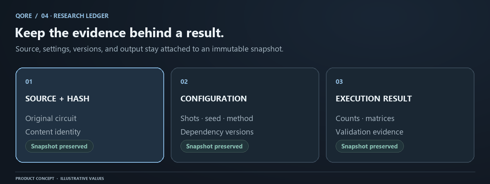
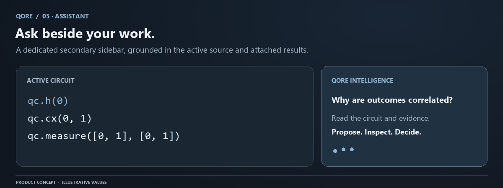
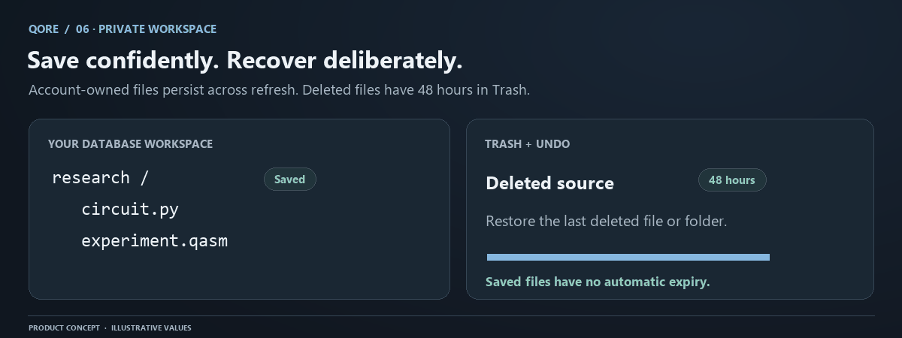
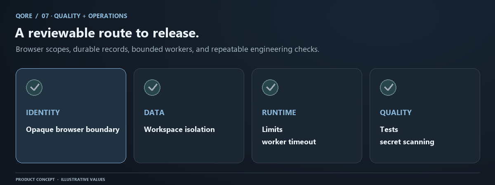
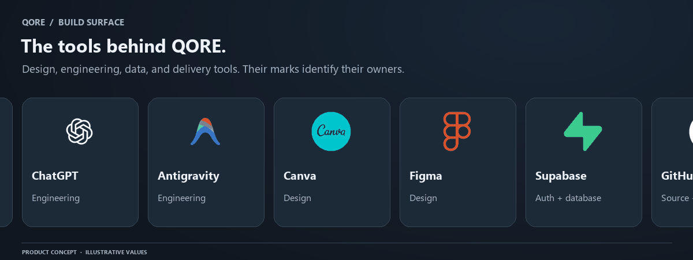

# QORE

**A quantum workspace for writing circuits, exploring states, and keeping the evidence **

[Open QORE](https://qore-bmh1.onrender.com/) · [Documentation](https://qoredocs.vercel.app/) · [Manual sources](docs/README.md) · [Report an issue](https://github.com/ganeshkumarchalla/Qore/issues)

## Problem statement

Quantum development is often split across disconnected editors, simulators, state visualizers, compiler tools, and experiment records. That fragmentation makes it easy to misread sampled output, lose execution context, compare stale results, or accept an optimization without evidence that it preserved the circuit. QORE brings source, bounded Qiskit and OpenQASM execution, ideal and sampled results, compiler validation, and reproducible experiment records into one traceable workspace.

In real-world education, research, and early-stage algorithm development, this connected workflow helps people move from an idea to evidence without manually transferring code and results between unrelated tools. Students can connect circuit changes to measurable outcomes, researchers can retain the exact source and execution settings behind a result, and engineering teams can review optimization candidates before applying them. QORE does not treat a visualization or a lower gate count as proof: it keeps simulator metadata, bit ordering, source identity, numerical output, and validation scope together so results can be explained, reproduced, and audited.

QORE's future direction is to extend this evidence-first model from local simulation toward provider-neutral execution adapters, optional quantum-hardware jobs, collaborative experiment review, scalable queued workloads, richer noise and device models, and stronger experiment lineage. These are roadmap goals rather than current capabilities. As the platform grows, the same principles remain fixed: explicit limits, secure server-side credentials, review before mutation, clear separation between ideal, simulated, and hardware evidence, and reproducibility from source to result.

QORE brings an editor, quantum simulator, visual laboratory, compiler workbench, and research ledger into one consistent glass interface. Write a circuit in the supported Qiskit Python subset or OpenQASM 2. Inspect actual simulator output, compare a compiler candidate, and preserve the source and evidence behind an experiment.

The workspace starts empty. **Get Started** creates a three-qubit learning circuit only when requested. No account is required: editable source is retained in the browser workspace, while server-side projects and evidence are isolated by an opaque HttpOnly workspace cookie. Saved files have no automatic expiry; deleted files and folders remain recoverable for **48 hours** through Undo and Trash.



These illustrations explain the product with representative values. Counts, timings, validation, and save status come from your actual execution. The images are animated GIF files that work in GitHub's README renderer. [Static posters and SVG sources](docs/assets/BRAND_ASSETS.md) are also available.

## A complete circuit workflow

### Studio — your workspace, your source



Create, rename, edit, and organize files and folders in Explorer. Monaco provides the code-editing surface; the current file path stays visible. The fixed graphite theme, readable typography, glass panels, and responsive layout carry across the workbench. Explorer can close to give Lab and Forge more room. The welcome logo animates and closes automatically.

[Studio guide](docs/features/studio.md) · [Files and recovery](docs/guides/workspace-files.md)

### Quantum Lab — understand the output



Run supported circuits through Qiskit Aer with explicit shots, seed, simulator method, and optional modeled noise. Compare sampled counts with ideal probabilities, explore State World, rotate focused or multi-qubit Bloch views, and inspect amplitudes, circuit diagrams, and unitary matrices within their display limits. Execution metadata and classical-bit mapping remain attached to the result.

[Quantum Lab](docs/features/quantum-lab.md) · [Bloch spheres](docs/quantum/bloch-spheres.md) · [Measurement ordering](docs/quantum/measurement.md)

### Forge — inspect a proposed transformation



Generate a compiler candidate at optimization levels 0–3. Compare gate counts, depth, and two-qubit operations. For up to six qubits, QORE compares complete operators up to global phase at a numerical tolerance of `1e-9`, and checks the exact terminal measurement mapping. Applying a candidate is an explicit action. Compilation alone is not an equivalence guarantee.

[Forge workflow](docs/features/forge.md) · [Equivalence reference](docs/quantum/equivalence.md)

### Research Ledger — preserve the context



Keep immutable experiment snapshots containing source, source hash, circuit IR, settings, dependency versions, and referenced execution results. Reopen historical evidence without silently changing it. Editing source clears stale live results, so an earlier histogram is never presented as the output of newly edited code.

[Research Ledger](docs/features/research-ledger.md) · [Reproducibility](docs/quantum/reproducibility.md)

### QORE Intelligence — assistance across the workbench



QORE Intelligence has a simple stacked secondary sidebar beside every active view. It receives the active view, workspace summary, diagnostics, circuit, and source-matched evidence. It can navigate QORE and invoke explicit simulation or optimization actions; model responses cannot silently edit source or approve candidates. The AI credential remains server-side and never enters the browser bundle.

[Assistant scope and privacy](docs/features/assistant.md)

### Private files — persistent and recoverable



Files and folders are created, renamed, moved, edited, and deleted directly in Explorer. The browser workspace persists across refreshes. Undo restores the last deleted batch; Trash restores other eligible entries. Backend records use a browser-specific opaque cookie and SQLite version checks; a Render persistent disk is required for those server records to survive service replacement.

The workspace allows **1,000 entries including Trash**, **16 MiB of aggregate source**, and **32 KiB per file**. Deleted content becomes unavailable at exactly 48 hours; scheduled cleanup removes expired source rows every five minutes. Database backups follow the operator's separate retention policy.

[Workspace files](docs/guides/workspace-files.md) · [Workspace API](docs/reference/workspace-api.md)

### Quality and operations — a reviewable release



Repeatable checks cover backend behavior, real Aer execution, frontend types/build, secrets, owner isolation, and immutable evidence. Daily specialist scopes cover Studio, quantum correctness, Forge, identity and records, the assistant, security, organization and scalability, and public-page SEO. Reports do not automatically promote unreviewed edits to production.

[Automated reviews](docs/AUTOMATED_REVIEWS.md) · [Testing](docs/operations/testing.md) · [Security](docs/operations/security.md)

## Technology and build surface



The build surface identifies the design and engineering tools used around QORE: ChatGPT, Antigravity, Canva, Figma, Supabase, GitHub, Render, Docker, PowerShell, and Codex Security. They have different roles; they are not all runtime dependencies or endorsements. Original marks, source URLs, and license notes are recorded in [asset provenance](docs/assets/BRAND_ASSETS.md).

| Layer | Technology | Role |
| --- | --- | --- |
| Workbench | React 18, TypeScript, Vite, Monaco | Responsive editor and application state |
| Interface | CSS, SVG, canvas and 3D views | Circuit diagrams, state inspection, glass surfaces |
| API | Python 3.11–3.13, FastAPI, Pydantic, Uvicorn | Validated requests and orchestration |
| Quantum runtime | Qiskit 2, Qiskit Aer | Construction, simulation, transpilation, operator analysis |
| Workspace data | Browser storage and SQLite | Editable files, projects, runs, and research records |
| Delivery | Docker, Render, GitHub Actions | Container hosting and review checks |
| Optional assistant | Server-side model-provider API | Circuit and result explanations |

## Run locally

Install Python 3.11–3.13, a Node.js release compatible with the pinned package manager, and pnpm. From the repository root:

```powershell
py -3.12 -m venv .venv
& .\.venv\Scripts\python.exe -m pip install -e ".[test,docs]"
Set-Location frontend
pnpm install --frozen-lockfile
pnpm build
Set-Location ..
& .\scripts\start.ps1
```

Open `http://127.0.0.1:8000`. No account setup is required. For hot reload, run `scripts/start.ps1 -Dev` and `pnpm dev` in separate terminals. See [local development](docs/guides/local-development.md) and [production setup](docs/PRODUCTION.md) for Render, Docker, persistent disks, and configuration.

## Execution scope

QORE supports its documented Qiskit circuit-building subset and OpenQASM 2, up to **10 qubits**, **10 classical bits**, **500 operations**, **32 KiB of source**, and **100,000 shots**. Bloch vectors and ideal amplitude displays are available up to six qubits; matrix display is available up to four. The command console exposes supported QORE actions and real attached results.

Arbitrary Python, unrestricted imports, operating-system shell commands, dynamic mid-circuit control, and hardware submission are outside this runtime. Optional SDK packages do not expand the public editor allowlist. [Compatibility and limits](docs/reference/limits.md)

## Documentation

The [manual](docs/README.md) contains separate user guides, product manuals, quantum lessons, API references, and operational playbooks. Start with:

- [Your first experiment](docs/guides/first-experiment.md): run and interpret a three-qubit GHZ circuit.
- [Quantum foundations](docs/quantum/foundations.md): amplitudes, interference, and useful limitations.
- [QAOA and graph cuts](docs/quantum/qaoa.md): inspect a four-qubit optimization experiment.
- [API](docs/reference/api.md): fields, result semantics, errors, and authorization.
- [Architecture](docs/reference/architecture.md): modules and data boundaries.
- [Operations](docs/operations/deployment.md): delivery, monitoring, recovery, and scaling.

## Verify a change

```powershell
& .\.venv\Scripts\python.exe -m pytest backend/tests -q
& .\.venv\Scripts\python.exe scripts/production_acceptance.py
& .\.venv\Scripts\python.exe scripts/security_checker.py --check
& .\.venv\Scripts\python.exe scripts/frontend_auditor.py
```

Run `pnpm test:ui` in `frontend` for browser interaction checks. The complete baseline is `scripts/daily_quality_report.py`. Reports distinguish mocked provider/browser checks from real numerical simulation and operator-reviewed integration checks. Generated evidence stays under the ignored `evidence/` directory.

## Repository structure

```text
backend/qore/          API, bounded quantum engine, workspace isolation and stores
backend/tests/         Regression and data-boundary tests
frontend/src/          Editor, Lab, Forge, Ledger, assistant
frontend/public/       Application icons and public product information
scripts/              Startup, audits, acceptance, documentation build
docs/guides/          Task-oriented user guides
docs/features/        Individual product manuals
docs/quantum/         Original concepts and worked lessons
docs/reference/       API, configuration, language, limits, data model
docs/operations/      Deployment, security, testing, scaling, recovery
docs/assets/          Animation sources and attributed logos
.github/workflows/    Repository quality checks
```

Credentials, environment files, databases, dependency trees, browser profiles, temporary reports, build caches, and promotional recordings stay outside published source. Backend secrets never belong in frontend bundles. Read the [security guide](docs/operations/security.md) before configuring a hosted instance.
